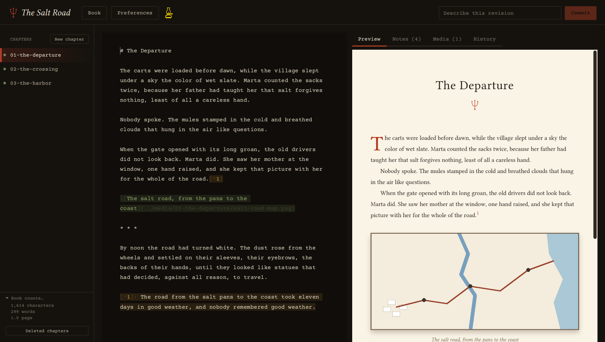
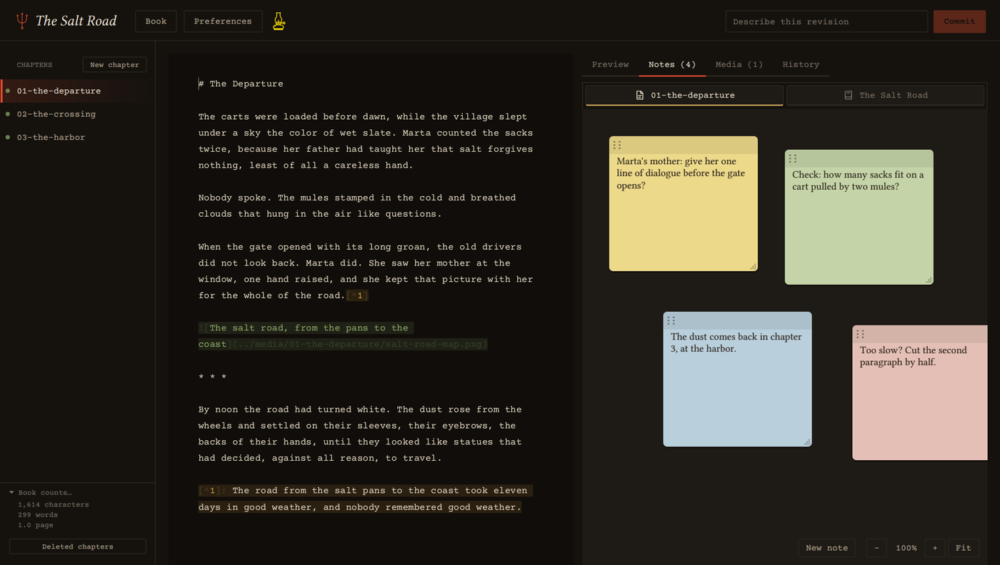
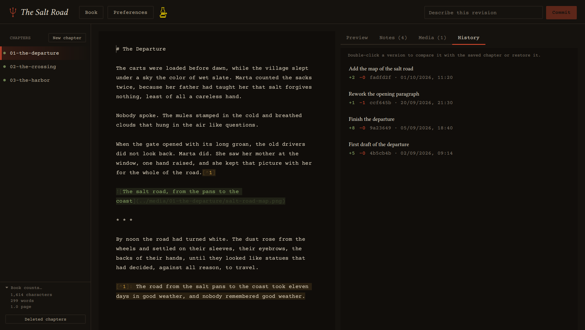
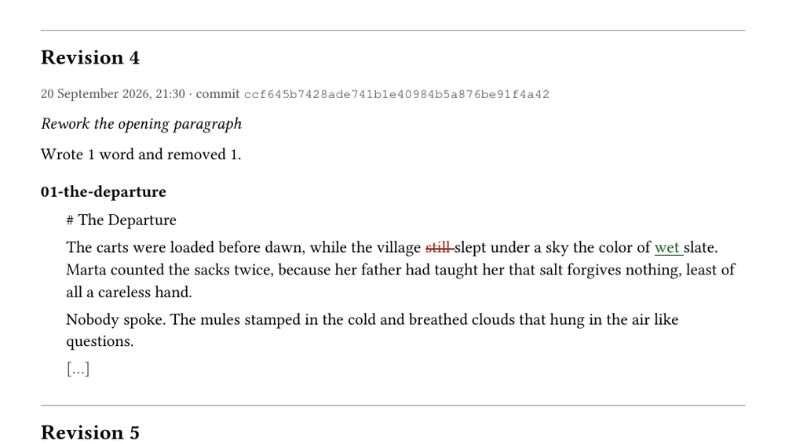

# Psiche Writer

A desktop editor for writing books in Markdown, with version history built in.

Each book is a plain folder of Markdown files with its own Git repository. You write chapters next to a live, typeset
preview, record revisions with one click, and look back at or restore any earlier version, without ever touching the
Git command line. Your manuscript stays in open, plain-text files that any other tool can read.



## Status

**0.9.0 Beta.** Psiche Writer covers a book from first draft to export, but it is not finished: keep a copy of your
books, and expect things to change before 1.0. What each release brings is in [CHANGELOG.md](CHANGELOG.md).

## What it does

- **Write** chapters in Markdown beside a typeset preview, in a default mode that keeps the markup discreet or an
  advanced one that shows it all. Footnotes, tables, images, links between chapters, find and replace, offline
  spell checking (English, Italian, French, Spanish, German, Portuguese), repeated words highlighted as you type, and
  word and page counts for the chapter and the whole book.
- **Keep notes** on a board of post-its for each chapter and one for the whole book, with files attached, and pin a
  note to the paragraph it is about.
- **Keep every version.** Commit with a short message; the History tab shows each version of a chapter as tracked
  changes, and restores it in one click. Deleted chapters can be brought back.
- **Work on several computers** by synchronizing the book with a repository on GitHub, GitLab or a USB drive, or move
  it whole as a single `.psiche` project file.
- **Export** a chapter or the whole book to a manuscript PDF, ODT or DOCX, or the book to EPUB for the stores and for
  Kindle, with title page, contents and cover.
- **Show how the book was written.** The *writing history* exports every revision of the chapters to one PDF, as
  evidence for a competition or a publisher that asks; any past revision of the book can be exported too.

<p>
  
  
  
</p>

*The screenshots show* The Salt Road, *a made-up book.*

The full guide to every feature is in [README_DETAILED.md](README_DETAILED.md).

## Download

Ready-made packages bring their own Java runtime, so there is nothing else to install. Get them from the
[Releases](https://github.com/davide-truzzi/psiche/releases) page:

- **Linux:** `psiche.AppImage`. Make it executable, then double-click it.
- **Windows:** `psiche-windows.zip`. Unzip it anywhere and run `psiche\psiche.exe`.

The packages are not signed yet, so Windows may ask you to confirm the first start. If Smart App Control blocks it,
use `psiche\psiche.cmd` in the same folder.

## Code signing policy

Free code signing provided by [SignPath.io](https://about.signpath.io), certificate by
[SignPath Foundation](https://signpath.org). Who builds, reviews and approves the signed releases, and what Psiche
sends over the network: [CODE_SIGNING_POLICY.md](CODE_SIGNING_POLICY.md).

## A book on disk

```
my-book/
├── chapters/     ← one Markdown file per chapter, ordered by name: 01-departure.md, 02-the-crossing.md…
├── media/        ← the book's properties, cover, ebook stylesheet, and each chapter's images
├── notes/        ← the notes, kept out of Git
└── .git/         ← the book's own history
```

> [!WARNING]
> While a book is open in Psiche Writer, don't change its chapter files with another program (another editor, a
> `git pull`, Dropbox or a similar sync client). Close the book first.

## Build from source

You need JDK 25; the Gradle wrapper downloads it if it is missing. Linux, Windows and macOS are supported.

```sh
./gradlew run                              # start the app
./gradlew run --args="/path/to/my-book"    # open a book on start
./gradlew test                             # run the tests
```

How to build the packages, the architecture and the known limitations are in
[README_DETAILED.md](README_DETAILED.md#packaging).

## Licence

Psiche Writer is free software under the [GNU General Public License v3](LICENSE) or later. The fonts and libraries it
ships with keep their own licences, listed in [README_DETAILED.md](README_DETAILED.md#licence).
